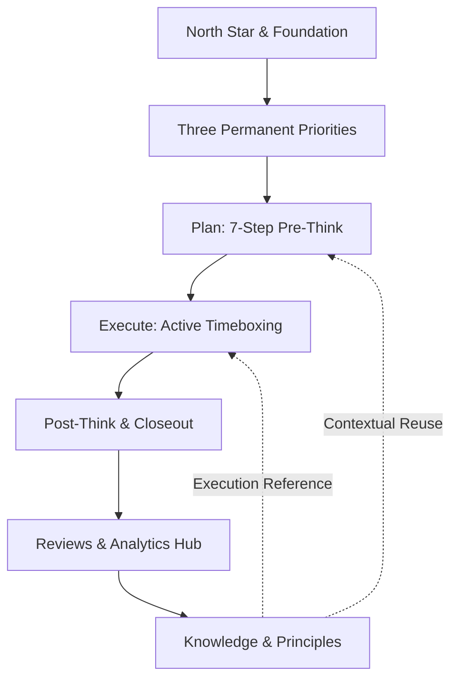

# Yash OS

> **Founder Operating System** — An evidence-driven execution engine designed to eliminate human friction, maintain strategic priority alignment, and compound daily outputs into scalable infrastructure.

[](https://github.com/your-username/yash-os/actions/workflows/ci.yml)
[](https://www.typescriptlang.org/)
[](https://react.dev/)
[](https://tanstack.com/router)
[](LICENSE)

---

## 1. Project Overview

**Yash OS** is a specialized personal operating system for founders and builders. Instead of treating work as disconnected to-do lists, Yash OS enforces a closed-loop operating paradigm:

$$\text{PRE-THINK} \longrightarrow \text{ACT} \longrightarrow \text{POST-THINK} \longrightarrow \text{IMPROVE} \longrightarrow \text{REPEAT}$$

### Core Operating Principles

- **Reality Over Assumptions**: Decisions and plans must be grounded in empirical time and evidence, not optimistic estimates.
- **Three Permanent Priorities**: All effort aligns to three invariant priorities, preventing distraction and priority drift.
- **Offline-First & Air-Gapped**: 100% of tasks, private notes, financial metrics, and reflections stay on your device in browser storage.
- **Compounding Knowledge**: Reusable principles, methods, and decision frameworks link directly to live tasks and historical reviews.

---

## 2. Product Architecture

The operating system is organized into eight integrated modules:



1. **Home (`/`)**: High-level operating state, vision statement (_"Find human friction. Solve problems. Build systems. Scale impact."_), North Star card, quick actions, and priority progress.
2. **Plan (`/plan`)**: A structured 7-step morning workflow guiding day context, backlog review, priority calibration, daily outcomes, task selection, time budgeting, and approval.
3. **Execute (`/execute`)**: Real-time focus workspace with active task timeboxing, countdown timer, priority task stack, task transitions, emergency redirection, and evening closeout.
4. **Projects (`/projects`)**: Project portfolio tracking tied to the three permanent priorities with milestones, hypotheses, bottlenecks, and execution documentation.
5. **Reviews (`/reviews`)**: Deep analytical engine featuring:
   - **Overview**: Trailing 7/14/30-day velocity, workstream distributions, and alert triggers.
   - **Analytics Hub**: Focus ratio, yield per hour, and historical trend comparisons.
   - **Daily / Weekly / Monthly / Quarterly Reviews**: Standardized post-think cadence and retrospective audits.
   - **Bottlenecks & Improvements**: Root-cause mitigation tracking and promotion of lessons into permanent knowledge.
   - **AI Analyst**: Algorithmic performance evaluation and reality-drift detection.
6. **Knowledge (`/knowledge`)**: Structured repository categorizing reusable wisdom into **Principles**, **Methods**, **Frameworks**, and **Custom** structures.
7. **Settings (`/settings`)**: Centralized two-panel desktop control panel and mobile drill-down for profile identity (circular avatar), appearance, workspace foundation, navigation, notifications, data storage, and diagnostics.
8. **Goals & Milestones (Overlay)**: Hierarchical long-term goal management tracking Level A (multi-year), Level B (annual), and Level C (quarterly priority milestones).

---

## 3. Technology Stack

- **Runtime & Framework**: [TanStack Start](https://tanstack.com/start) / [TanStack Router](https://tanstack.com/router) with full type-safe file-based routing.
- **UI Library**: [React 19](https://react.dev/)
- **Styling**: [Tailwind CSS v4](https://tailwindcss.com/) with high-performance glass surfaces, custom CSS variables, and fluid typography (Sora & Manrope).
- **Icons**: [Lucide React](https://lucide.dev/)
- **Data Visualization**: [Recharts](https://recharts.org/) for execution distributions and historical velocity charts.
- **Persistence**: Offline-first LocalStorage engine with automatic snapshot migration (`schemaVersion: 2`).
- **Testing**: [Vitest](https://vitest.dev/) + [Testing Library](https://testing-library.com/) with jsdom.
- **Build Engine**: [Vite 8](https://vitejs.dev/) with [Nitro](https://nitro.unjs.io/) server generation.
- **Type Checking**: TypeScript 5.8 in strict mode with `exactOptionalPropertyTypes` and `noUncheckedIndexedAccess`.

---

## 4. Project Structure

```
yash-os/
├── .github/
│   └── workflows/
│       └── ci.yml             # Automated CI pipeline (lint, typecheck, test, build)
├── public/                    # Static public assets
├── src/
│   ├── assets/                # Core brand artwork (hero imagery, orb logo)
│   ├── components/
│   │   ├── os/                # Yash OS core components
│   │   │   ├── reviews/       # Review views (Daily, Weekly, Monthly, AnalyticsHub, etc.)
│   │   │   ├── settings/      # Settings module sections (Profile, Appearance, Workspace, etc.)
│   │   │   ├── AppShell.tsx   # Global shell (sidebar, navigation, profile header)
│   │   │   ├── GoalsPanel.tsx # Goals & Milestones slide-over modal
│   │   │   ├── ProfileAvatar.tsx # Reusable circular profile avatar with fallback initials
│   │   │   └── ui.tsx         # Standardized glass UI primitives (Modal, Button, Input, etc.)
│   │   └── ui/                # Underlying Radix-based UI building blocks
│   ├── hooks/                 # Reusable React hooks
│   ├── lib/
│   │   ├── os/                # Core domain business logic
│   │   │   ├── reviews/       # Review calculators, analytics, migrations, and export
│   │   │   ├── avatar.ts      # Profile image validation, crop & client-side compression
│   │   │   ├── knowledge.ts   # Knowledge serialization, format validation & badges
│   │   │   ├── logic.ts       # Priority synchronization, task selection, time budgets
│   │   │   ├── seed.ts        # Initial seed state and factory defaults
│   │   │   ├── store.tsx      # React Context state store with LocalStorage persistence
│   │   │   └── types.ts       # Central TypeScript domain interfaces
│   │   └── utils.ts           # Class merging utilities (clsx + tailwind-merge)
│   ├── routes/                # File-based TanStack routes
│   │   ├── __root.tsx         # Application root layout with error boundary & Toaster
│   │   ├── index.tsx          # Home page
│   │   ├── plan.tsx           # 7-step daily planning route
│   │   ├── execute.tsx        # Execution & active timer route
│   │   ├── projects.tsx       # Project management route
│   │   ├── reviews.tsx        # Reviews hub route
│   │   ├── knowledge.tsx      # Knowledge format & reusability route
│   │   └── settings.tsx       # Centralized Settings control panel
│   ├── router.tsx             # TanStack Router instance & preloading configuration
│   ├── server.ts              # Nitro / TanStack Start SSR entry handler
│   ├── start.ts               # Server function & CSRF middleware configuration
│   ├── styles.css             # Tailwind v4 theme, atmosphere, and motion tokens
│   └── test/                  # Automated test suites (60+ unit & integration tests)
├── .env.example               # Environment variable specification
├── .gitignore                 # Standard production git ignore rules
├── .prettierignore            # Formatting exclusions for generated code
├── .prettierrc                # Prettier configuration
├── eslint.config.js           # ESLint flat configuration
├── package.json               # Package manifests and scripts
├── tsconfig.json              # TypeScript strict configuration
└── vite.config.ts             # Vite & TanStack Start build configuration
```

---

## 5. Getting Started

### Prerequisites

- **Node.js**: `v20.x` or `v22.x` (v22 recommended)
- **Package Manager**: `npm` (included with Node.js)

### Installation

```bash
# Clone the repository
git clone https://github.com/your-username/yash-os.git
cd yash-os

# Install dependencies deterministically
npm ci

# Start the local development server
npm run dev
```

Visit [http://localhost:3000](http://localhost:3000) in your browser.

---

## 6. Environment Configuration

Yash OS is designed with an offline-first architecture; it runs entirely out of the box without requiring external API keys.

To configure optional overrides, copy `.env.example` to `.env.local`:

```bash
cp .env.example .env.local
```

| Variable           | Type     | Default   | Purpose                                               |
| :----------------- | :------- | :-------- | :---------------------------------------------------- |
| `PORT`             | Optional | `3000`    | Port for the local development server.                |
| `HOST`             | Optional | `0.0.0.0` | Host interface binding.                               |
| `VITE_AI_PROVIDER` | Optional | `gemini`  | Reserved for future external AI analyst provider.     |
| `VITE_AI_API_KEY`  | Optional | `—`       | Reserved for future external AI insights integration. |

---

## 7. Available Commands

All scripts are configured in `package.json`:

```bash
# Start development server with live reload on port 3000
npm run dev

# Run TypeScript compilation check
npm run typecheck

# Run ESLint validation across the repository
npm run lint

# Format code with Prettier
npm run format

# Verify code formatting matches Prettier rules (used in CI)
npm run format:check

# Run complete automated test suite via Vitest
npm test

# Run tests in interactive watch mode
npm run test:watch

# Compile production bundle
npm run build

# Preview production build locally
npm run preview
```

---

## 8. Testing and Quality Checks

The repository includes comprehensive automated test coverage across domain logic, routing, settings, reviews, and knowledge management:

```bash
npm run typecheck    # 0 errors
npm run lint         # 0 errors
npm run format:check # All files match Prettier style
npm test             # 61 tests passing across 10 test suites
```

### Key Test Suites:

- `src/test/settings-module.test.ts`: Verifies eight-category settings mapping and metadata integrity.
- `src/test/avatar-settings.test.ts`: Tests image format validation, file size limits, initials generation, and state migration.
- `src/test/knowledge-enhancement.test.ts`: Validates Principle, Method, Framework, and Custom knowledge structures and contextual linking.
- `src/test/reviews-foundation.test.ts`: Verifies review state transitions, audit history, and analytics math.
- `src/test/reviews-finalization.test.ts`: Tests daily closeout finalization and recalculation.
- `src/test/priority-project-sync.test.ts`: Ensures priority metadata remains synchronized with active projects.
- `src/test/os-logic.test.ts`: Validates task selection and time budgeting algorithms.

---

## 9. Architecture and Data

### State Management & LocalStorage

- **Unified Context Store**: Managed via `OSProvider` (`src/lib/os/store.tsx`). State mutations are functional and dispatched through a typed updater.
- **Persistence Key**: State is synchronized to `localStorage` under key `yash-os-v1`.
- **Automatic Schema Migration**: `migrateOSState()` in `src/lib/os/reviews/migrations.ts` seamlessly migrates older client states to `CURRENT_SCHEMA_VERSION = 2`.
- **Backups**: Full JSON export and import with validation are available in Settings -> Data & Storage.

### Data Model Highlights

- **Plan**: Contains daily outcomes, tasks, energy context, and day type hours.
- **Priority**: Invariant Priorities #1, #2, and #3, each linking to active projects and bottlenecks.
- **DayRecord**: Historical audit log recording planned minutes, actual minutes, tasks done, and evidence outputs.
- **KnowledgeItem**: Typed wisdom entries categorized by `knowledgeFormat` (`principle`, `method`, `framework`, `custom`).

---

## 10. CI/CD Pipeline

Automated quality verification runs on every push and pull request to `main` via GitHub Actions (`.github/workflows/ci.yml`):

1. **Dependency Installation**: `npm ci` with caching.
2. **Code Style Verification**: `npm run format:check`.
3. **Static Analysis**: `npm run lint`.
4. **Type Check**: `npm run typecheck` (`tsc --noEmit`).
5. **Unit & Integration Tests**: `npm test` (`vitest run`).
6. **Production Compilation**: `npm run build`.

---

## 11. Deployment

Yash OS uses Nitro as its server generation layer, making it deployable across major edge and static providers:

### Cloudflare Pages / Workers

The project builds natively with preset `cloudflare-module`:

```bash
npm run build
npx nitro deploy --prebuilt
```

### Static / Node Hosts (Vercel, Netlify, Docker)

You can configure Nitro presets or host the generated SSR bundle from `.output/server/index.mjs` with Node.js:

```bash
node .output/server/index.mjs
```

---

## 12. Current Limitations

- **Local Storage Quota**: Offline browser storage is limited to ~5MB per domain by browsers. Yash OS optimizes avatar images to ~20KB to ensure generous headroom, but users should periodically export JSON backups.
- **Cross-Device Sync**: Multi-device real-time sync is currently client-driven via manual JSON backup export/import; serverless sync adapter interfaces are stubbed in `src/lib/os/reviews/service/cloudAdapterContract.ts` for future phases.
- **Single-User Scope**: Designed as an individualized operating system; multi-tenant teams require dedicated workspace segregation.

---

## License

This project is licensed under the [MIT License](LICENSE).
